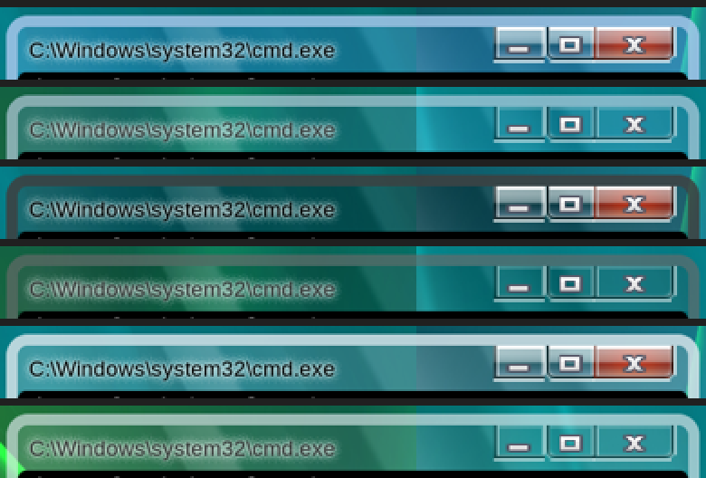
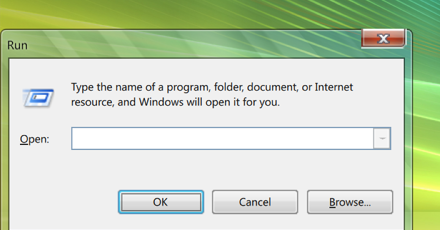
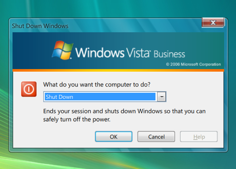
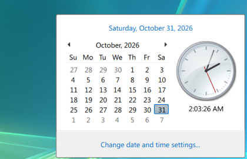
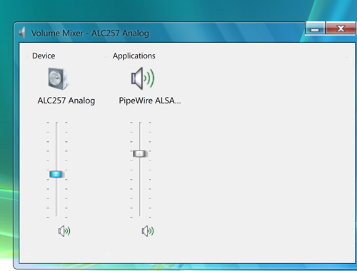
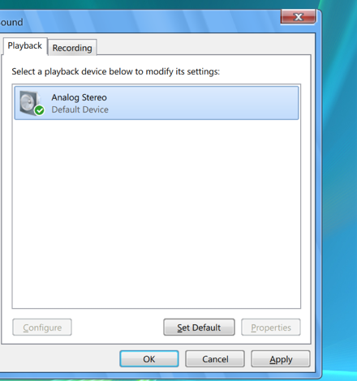
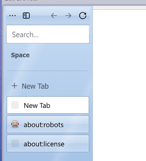

# Windows Vista for Omarchy

The Windows Vista look for [Omarchy](https://omarchy.org) 4 (Quattro), in four
colour schemes: Aero (the default glass), Aero Graphite, Aero Frost and Vista
Basic (opaque, no blur: the battery-friendly one). It changes nothing else
about your desktop, and any non-Vista theme puts the previous look back
exactly.



What you get, built from Vista's own files (downloaded on your machine,
see below):

- **Windows:** Aero glass title bars (the scheme's colorization over blur,
  the DWM reflection, Vista's joined caption buttons hung from the top edge,
  black titles with their glow) or Vista Basic's opaque ones, from a patched
  hyprbars built for your Hyprland.
- **Taskbar:** the Start orb, Quick Launch, task buttons, the notification
  area with Vista's own icons, the clock.
- **Start menu:** Vista's two columns, All Programs in place, Start Search
  on Omarchy's launcher, the power, lock and arrow menu.
- **Flyouts and windows:** clock (calendar and analog clock), volume, Volume
  Mixer and Sound, battery and power plans, network (Status, Details, Connect
  to a network), Bluetooth, Display Settings, weather, Run (Win+R), Shut Down
  Windows: laid out from Vista's own dialog templates where they exist.
- **Logon screen** as the lock screen, **User Account Control** as the
  polkit prompt, Vista **balloons**, a quiet OSD, Vista's **sounds**.
- **Windows Sidebar** (off until you turn it on: Start > All Programs >
  Windows Sidebar) with the Clock, CPU Meter, Slide Show and Weather gadgets.
- **cmd.exe** console (`C:\Users\you>`), the Vista GTK theme, icons and
  pointers, Segoe UI, a Vista fastfetch, an IE7-style Zen.
- An optional **boot splash** (below).

| | |
|---|---|
|  |  |
|  |  |
|  |  |

Screenshots taken on the author's machine with this package installed (they
show Vista's art as this package draws it from the downloaded files).

## Install

From a terminal in your Omarchy session, as yourself (not root):

```sh
./install.sh            # or: ./install.sh --dry-run  to see every step first
```

It asks for sudo only if a package it needs is missing, downloads
Microsoft's files (below, about 100 MB the first time), builds the title-bar
plugin, and ends on
`omarchy theme set windows-vista`. Open a new terminal afterwards.

Switch schemes like any Omarchy theme: `windows-vista`,
`windows-vista-graphite`, `windows-vista-frost`, `windows-vista-basic`.

**Update:** `git pull && ./install.sh` (safe to re-run).

**Uninstall:** `./uninstall.sh` switches to Omarchy's default theme, then
removes everything it installed in your account (and the folders it
created; tool caches such as fontconfig's stay, as for any font change).

## Windows XP side by side

[omarchy-windows-xp](https://github.com/AI-Ocko/omarchy-windows-xp) can be
installed at the same time. The two share no files. Each one's theme hooks
undo it first when you leave it (`00-windows-*-off`) and apply it last when
you enter it (`zz-windows-*-on`), and each `on` turns the other off if it is
still on, so switching XP <-> Vista <-> anything else always restores the
right state. Uninstalling either leaves the other working.

## What it changes outside its own folders

- `~/.config/foot/foot.ini`, `~/.bashrc`, `~/.config/tmux/tmux.conf`: one
  marked block each (`# >>> omarchy-windows-vista`), with a `.pre-vista`
  backup.
- `~/.config/omarchy/{themes,plugins,hooks}`: the four schemes, the
  `ocko.vista-*` shell plugins and the theme hooks; `~/.local/lib/hyprbars-vista`
  (the title-bar plugin, built here); a `vista-sizes.path` systemd user unit
  that keeps the console font in step with `omarchy display text size`.
- `~/.local/share/{fonts/vista, themes/Windows Vista, icons/windows-vista,
  icons/windows-vista-cursors}`.
- While a Vista theme is on, and put back exactly when you leave it
  (`~/.local/state/omarchy/vista/saved-state.json` and `orig/`):
  `~/.config/omarchy/shell.json` (the Vista bar and plugins are selected;
  your own clones of the same stock plugins are disabled meanwhile, so
  `omarchy-shell` calls reach the Vista ones), gsettings fonts and pointer,
  `~/.config/gtk-3.0/gtk.css` moved aside, `~/.config/gtk-4.0/gtk.css`
  linked to the scheme's palette, `~/.config/fastfetch/config.jsonc`,
  `~/.config/omarchy/branding/{about,screensaver}.txt`, your Zen profile's
  `chrome/userChrome.css` (a link), a Hyprland toggle file (geometry, the
  title bars, Win+R), and the tmux status bar.
- Nothing system-wide unless you choose the boot splash.

## Boot splash (optional)

`~/.config/omarchy/vista/bin/vista-boot` installs a Plymouth theme: Vista's
black boot screen with the green bar, a disk-password prompt in the same
style, and the shutdown screen. It is the only part that uses sudo, and it
changes how your machine boots, so try it first:

```sh
vista-boot install            # copies the theme, default unchanged
vista-boot preview boot       # (and: password, shutdown) in a window
vista-boot on                 # make it the default, rebuild the boot images
```

If it ever misbehaves at boot: press Esc for the text prompt (typing the
disk password blind also works) or pick a Limine snapshot, then
`vista-boot off`.

## Omarchy and Hyprland versions

Every shell plugin copies stock Omarchy code; `VERSION` lists what it was
built against and which stock files each one copies (sha256). On each
switch to Vista, `vista-compat-test` checks them against the Omarchy you
have: a part an update broke falls back to Omarchy's own (one notification
per change), the rest stay Vista. The title bars are tied to Hyprland 0.56.x
and are rebuilt by themselves after a Hyprland update (one notification if
that fails); on another Hyprland version the stock bars are used.

## Microsoft's files are not in this repository

`~/.config/omarchy/vista/fetch-assets.sh` (run by the installer) downloads
them on your machine, for your personal use, into
`~/.config/omarchy/vista/assets/`: individual files of a Windows Vista SP2
DVD from **archive.org** (or, with `--iso PATH`, from a DVD image you have),
and the B00merang Windows Vista GTK theme (GPL-3.0) from **GitHub**. They
are Microsoft's copyrighted originals pulled from a third-party archive.
Every download is pinned by sha256; a changed file fails the run instead of
being used, and nothing downloaded is ever executed. None of it is ever
committed here. Details: `ASSETS.md`.

## Licence

MIT (see `LICENSE`), including code copied from Omarchy (MIT) and from
omarchy-windows-xp (MIT). See `NOTICE.md`.
